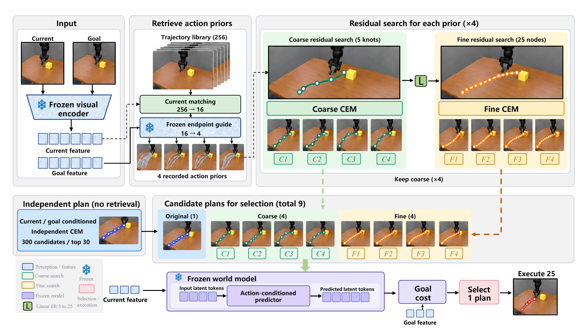

# TGR 源码使用说明

本目录整理了当前方法的实际实现、框架图、安装配置和已完成的实验数据。没有加入论文稿件、投稿链接、录用标记或虚构引用。

## 方法与入口

TGR 在冻结视觉世界模型上进行轨迹引导规划：检索已有动作先验，先搜索具有时间结构的粗残差，再提升到逐命令残差进行细化；独立搜索计划、粗计划和细计划一起参加最终选择。离线端点引导只影响检索排序，最终评分仍使用原始世界模型目标代价。



- 核心方法：[`refinement.py`](../src/tgr/refinement.py)、[`coarse.py`](../src/tgr/coarse.py)。
- 统一调用接口：[`planner.py`](../src/tgr/planner.py)。
- 安装、数据目录和运行命令：[英文 README](../README.md)。
- 全部配置：[`experiment.json`](../configs/experiment.json)。
- 评测入口：[`evaluate.py`](../scripts/evaluate.py)。
- 与论文一致的展示表：[`all_methods_display.csv`](../results/all_methods_display.csv)；原始精度数据：[`all_methods.csv`](../results/all_methods.csv)。

## 已包含与需另备的资源

源码包已包含四个轨迹库、36个固定引导头、动作统计、离线训练/验证特征与数值标签，以及完整 S1/S2 结果。世界模型检查点作为配套压缩包单独交付，解压到仓库根目录后得到 `checkpoints/`。HDF5 环境数据需另行放入 `external_data/`，详细路径见英文 README。

正式评测沿用固定头，不需要重新训练或调用在线视觉 API。安装不会启动评测、监控、远程连接或后台任务。

## 主要结果

| 环境 | 成功率 | 95% root 聚类区间 |
|---|---:|---|
| TwoRoom | **98%** | [94.14, 99.22] |
| PushT | **94%** | [89.84, 96.35] |
| Cube | **83%** | [75.91, 88.02] |
| Reacher | **83%** | [77.21, 86.85] |
| 四环境平均 | **89%** | — |

以上为 S1 完整独立任务评测。与论文一致，所有方法、预算和分组的成功率展示均向上取整为整数百分比；四环境平均先用原始精度计算，再向上取整显示为 89%。置信区间和百分点差值仍由原始数据计算，显示两位小数。原始记录及完整对照均保留；S2 首次计划候选执行机制结果独立存放。

## 最快核验方式

仅需 Python 标准库，即可核验包内文件及全部主实验结果：

```bash
python scripts/verify_release.py
```

安装依赖后可以运行 CPU 等价测试：

```bash
python tests/test_solver_parity.py
```

代码打包只进行了独立的工程验证，没有启动新一轮科研实验，也没有改动原实验结果。
